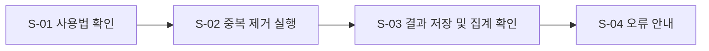

# CSV 중복 행 제거 CLI

Instructions for coding agents (Codex and others) working in this repository.

<!-- Seedup brief: project=prd:3aa85535-68de-4a51-b702-6ad0a6374fd7 goal=1 prd=bd6facf15025e3a5 -->

On session start or after resuming or compaction, pass the full version line above as the `brief` argument to `resume_project`.

> HYPOTHESIS DRAFT: the evidence is below the qualification bar. Confirm with real users before building beyond a prototype.

## Project key
`prd:3aa85535-68de-4a51-b702-6ad0a6374fd7`

## Rules
- Ship one feature at a time and keep each change small.
- For a Seedup project, at session start or after compaction or resuming, call resume_project {"project":"prd:3aa85535-68de-4a51-b702-6ad0a6374fd7"} before working, then get_next_task {"slug":"prd:3aa85535-68de-4a51-b702-6ad0a6374fd7"} to pick a feature. Before stopping, leave a handoff with save_handoff for the same project.
- For a Seedup project, call update_feature_status when each feature starts (in_progress) and ends (done with checks or blocked).
- Name the PRD feature in the commit message, for example Implements F-03 (R-2 ← E-5, E-9).
- If the user has enabled commit uploads for this project, call link_commit after each commit with the project key, commit SHA, message, and changed files (`git diff --name-only HEAD~1`).
- Ask the user in the terminal before changing the locked goal or scope. Record their answer with record_decision.
- Every feature must trace to a requirement and every requirement to user evidence below. Do not add work that has no source. Ask first.
- When a readiness slot says "open question", ask instead of guessing.
- Treat these unverified ideas as out of scope until validated: H-01 사용자는 헤더를 지키고 값이 완전히 같은 행 중 첫 행만 남긴 CSV를 얻을 수 있어야 한다, H-02 사용자는 지운 행 개수와 남긴 행 개수를 실행 결과로 받을 수 있어야 한다, H-03 사용자는 전체 열 대신 지정한 열의 값만으로 중복을 판정할 수 있어야 한다, H-04 사용자는 원본을 덮어쓰지 않고 지정한 경로에 결과 파일을 저장할 수 있어야 한다, H-05 사용자는 쉼표가 아닌 구분자로 된 CSV를 처리할 수 있어야 한다, H-06 사용자는 앞뒤 공백이나 대소문자 차이를 무시하고 중복을 판정할 수 있어야 한다.

## Locked goal (v1)
CSV를 자주 합치는 1인 개발자가 중복 행을 손으로 찾지 않고 명령 한 줄로 지우고, 몇 개를 지웠는지 바로 안다.

## Problem
여러 출처의 CSV를 한 파일로 합치면 같은 행이 두 번 이상 들어간다. 중복을 지우려면 어떤 열을 기준으로 같은 행인지 정하고, 그 기준으로 남길 행과 버릴 행을 가른 뒤, 몇 개를 버렸는지 따로 세어야 한다. 기획자는 이 일을 혼자 반복하는 1인 개발자로 범위를 좁혔다. 첫 버전은 웹 화면, xlsx 파일, 퍼지 매칭을 만들지 않고 Node 표준 라이브러리만 쓴다.

## Technical design

### Architecture
CLI가 인자를 해석해 파일 하나를 메모리로 읽는다. 파서가 파일 전체를 한 번 훑어 헤더와 데이터 행 배열을 만들고, 판정기가 열 지정에 따라 각 행의 키를 만들어 Set에 넣으며 처음 보는 키의 행만 결과 배열로 옮기고 나머지는 버린 배열로 옮긴다. 마지막에 쓰기 단계가 결과 배열을 CSV 문자열로 되돌려 출력 경로에 쓰고, 집계 단계가 두 배열의 길이를 표준 출력에 낸다. 네 단계는 같은 프로세스 안에서 순서대로 돌고, 중간 상태를 디스크에 남기지 않는다.

### Data model
- ParsedCsv: header(문자열 배열 또는 null), rows(문자열 배열의 배열), delimiter(문자).
- RowKey: 판정에 쓰는 열 인덱스 목록과 그 열들의 값을 이어 붙인 문자열.
- DedupResult: keptRows(문자열 배열의 배열), removedRows(문자열 배열의 배열), removedCount(숫자), keptCount(숫자).

### Interfaces
- node dedupe-csv.mjs <입력경로> [--out <경로>] [--keys <이름|번호,...>] [--delimiter <문자>] [--no-header] [--trim] [--ignore-case]: 입력을 읽어 결과 CSV 파일을 쓰고, 표준 출력에 removed: <숫자>와 kept: <숫자>를 낸다.
- 종료 코드: 0은 성공, 1은 파일을 읽거나 쓰지 못한 경우, 2는 인자가 잘못된 경우(없는 열 지정, 출력 경로가 입력 경로와 같음, 없는 옵션).
- 표준 오류: 열 개수가 헤더와 다른 행마다 line <번호>: expected <n> columns, got <m> 형식의 경고를 한 줄씩 낸다.

### Stack and rationale
- Node.js 20 LTS, 단일 .mjs 파일: 설치나 빌드 없이 node만으로 실행되고, 외부 패키지를 쓰지 않기로 한 범위에 맞는다.
- node:fs의 readFileSync, writeFileSync, mkdirSync: 파일 하나를 통째로 다루는 데 필요한 세 동작만 쓴다.
- 직접 쓴 문자열 상태 기계 파서: 값 안의 줄바꿈 때문에 행 단위로 읽는 API를 쓰면 행이 쪼개진다. 전체 문자열을 한 번 훑는 편이 이 문제를 피한다.
- node:test과 node:assert: 테스트를 외부 패키지 없이 node --test로 돌린다.

### Implementation order
1. 파일을 읽어 큰따옴표를-aware 파서로 행 배열을 만들고 첫 줄을 헤더로 분리한다 (F-01)
2. 열 지정에 따라 키를 만들어 Set에 없는 행만 남기고 나머지를 센다 (F-02)
3. 결과를 CSV 문자열로 직렬화해 출력 경로에 쓰고 입력 경로와 같으면 쓰기를 거부한다 (F-03)
4. removed와 kept 두 줄을 표준 출력에 내고 잘못된 인자에 종료 코드 2를 반환한다 (F-04)
5. 구분자 옵션과 열 개수 불일치 경고를 붙인다 (F-01, F-02)

## Features
- [ ] F-01 CSV 파서와 헤더 분리
  - (P0) 파일 전체를 읽어 구분자와 큰따옴표 규칙으로 행 배열을 만들고, 첫 줄을 헤더로 떼어 데이터 행 목록과 구분자를 돌려준다.
  - Serves: 
  - inputs: 입력 CSV 파일 경로를 필수 인자로 받는다. / --delimiter 옵션으로 구분자를 받으며, 생략하면 쉼표(,)를 기본값으로 사용한다. / 구분자는 한 문자로 처리하고 파일 전체를 텍스트로 읽어 메모리에 올린다. / 확인 필요: 파일 인코딩이 UTF-8이 아니거나 BOM이 있는 경우 처리 방식
  - rules: 파일 전체를 읽어 구분자와 큰따옴표 규칙으로 행 배열을 만든다. / 큰따옴표로 감싼 값 안의 구분자와 줄바꿈은 한 행의 일부로 처리하고, 큰따옴표 안의 ""는 하나의 큰따옴표 문자로 해석한다. / 첫 줄을 헤더로 분리하고 나머지를 데이터 행 목록으로 반환하며 구분자도 함께 반환한다. / 출력 CSV는 입력과 동일한 구분자로 기록한다.
  - errors: 데이터 행의 열 개수가 헤더와 다르면 표준 오류에 행 번호, 기대 열 개수, 실제 열 개수를 출력하고 해당 행은 지우지 않고 순서를 유지해 출력한다. / 파일이 없거나 읽을 수 없으면 표준 오류에 사유를 출력하고 0이 아닌 종료 코드로 종료한다. / 확인 필요: 닫히지 않은 큰따옴표 등 잘못된 CSV 형식을 만났을 때의 처리 방식
  - access: 개인용 로컬 CLI 도구이므로 별도 인증·인가나 사용자 권한 관리는 구현하지 않는다. / 파일 읽기와 쓰기는 운영체제 파일 시스템 권한을 따른다. / 확인 필요: 출력 파일을 원본에 덮어쓸지 새 경로에 저장할지
  - data: 데이터베이스를 사용하지 않고 CSV 파일만 처리한다. / 외부 패키지 없이 Node.js 표준 라이브러리만 사용한다. / 파싱 결과는 헤더(문자열 배열), 데이터 행(문자열 배열의 배열), 구분자로 표현한다.
  - done: 큰따옴표 안의 구분자와 줄바꿈이 포함된 값을 한 행으로 정확히 파싱하는 테스트를 통과한다. / 기본 쉼표와 지정 구분자 모두에서 헤더와 데이터 행을 올바르게 분리하는 테스트를 통과한다. / 열 개수가 다른 행에서 표준 오류 메시지와 행 유지·순서 보장을 검증하는 테스트를 통과한다.
- [ ] F-02 중복 판정과 첫 행 유지
  - (P0) 헤더와 열 지정, 정규화 옵션을 받아 각 데이터 행의 판정 키를 만들고, 한 번도 본 적 없는 키의 행만 순서대로 남겨 결과 행 목록과 버린 행 목록을 돌려준다.
  - Serves: 
  - inputs: 필수 입력값은 입력 CSV 파일 경로 하나다. / --keys 옵션으로 중복 판정 기준 열을 헤더 이름(예: email,name) 또는 1부터 시작하는 열 번호(예: 3)로 쉼표 구분해 지정하고, 생략하면 모든 열을 기준으로 판정한다. / --trim과 --ignore-case는 값 없이 켜는 플래그로, 각각 판정 키의 앞뒤 공백 제거와 대소문자 통일을 활성화한다. / 입력 CSV는 큰따옴표로 감싼 값 안에 쉼표와 줄바꿈을 포함할 수 있다.
  - rules: 각 데이터 행에서 판정 키를 만들고, 한 번도 본 적 없는 키의 행만 입력 순서대로 결과에 남기며 버린 행 목록도 함께 반환한다. / --keys를 주면 지정한 열들의 값이 모두 같을 때만 중복으로 보고, 없으면 모든 열 값이 같을 때 중복으로 본다. / --trim·--ignore-case는 판정 키에만 적용하고 출력에는 먼저 나온 행의 원래 값을 그대로 유지한다. / 첫 행은 헤더로 간주해 항상 결과 맨 앞에 두고 중복 판정에서 제외하며, 최종적으로 제거된 행 개수를 출력한다.
  - errors: 입력 파일이 없거나 읽을 수 없으면 표준 오류에 메시지를 남기고 0이 아닌 종료 코드로 끝낸다. / --keys로 지정한 헤더 이름이 없거나 열 번호가 실제 열 범위를 벗어나면 오류로 처리하고 파일을 변경하지 않는다. / 큰따옴표가 닫히지 않는 등 CSV 형식이 깨지면 오류로 처리한다. / 확인 필요: 모든 값이 비어 있는 빈 줄을 데이터 행으로 보는지 아니면 무시하는지.
  - access: 개인용 로컬 CLI 도구이므로 별도 인증·인가 없이 실행한 OS 사용자의 파일 권한으로 동작한다. / 확인 필요: 결과를 원본 파일을 덮어쓰는지, 새 파일로 저장하는지, 표준 출력으로 내보내는지.
  - data: DB를 사용하지 않고 모든 행과 판정 키를 메모리에서 처리한다. / 확인 필요: 처리 가능한 최대 파일 크기·행 수 제한이 있는지(대용량 파일 처리 시 메모리 전략).
  - done: 중복이 있는 CSV를 넣으면 첫 행만 남고 제거된 행 개수가 출력된다. / 헤더가 결과 첫 행으로 유지되고 --keys·--trim·--ignore-case의 단독 및 조합 동작이 검증된다. / 큰따옴표 안의 쉼표와 줄바꿈이 한 행으로 처리되는 테스트가 통과한다. / 외부 패키지 없이 Node 표준 라이브러리만으로 동작함을 확인한다.
- [ ] F-03 결과 파일 쓰기와 원본 보존
  - 결과 행 목록과 출력 경로를 받아 CSV 문자열로 직렬화해 쓰고, 입력 경로와 같으면 쓰지 않고 실패를 돌려준다.
  - Serves: 
  - inputs: 확인 필요: 입력·상태 조건 항목에 어떤 조건을 정할까요? 자동 보완은 P0에 우선 배정했습니다.
  - rules: 확인 필요: 비즈니스 규칙 항목에 어떤 조건을 정할까요? 자동 보완은 P0에 우선 배정했습니다.
  - errors: 확인 필요: 예외·오류 처리 항목에 어떤 조건을 정할까요? 자동 보완은 P0에 우선 배정했습니다.
  - access: 확인 필요: 권한·접근 제어 항목에 어떤 조건을 정할까요? 자동 보완은 P0에 우선 배정했습니다.
  - data: 확인 필요: 데이터·스키마 요건 항목에 어떤 조건을 정할까요? 자동 보완은 P0에 우선 배정했습니다.
  - done: 확인 필요: 테스트·완료 기준 항목에 어떤 조건을 정할까요? 자동 보완은 P0에 우선 배정했습니다.
- [ ] F-04 집계 출력
  - (P0) 버린 행 목록과 남긴 행 목록을 받아 removed, kept 두 줄을 표준 출력에 내고, 잘못된 인子和에 대해서는 표준 오류 메시지와 종료 코드를 돌려준다.
  - Serves: 
  - inputs: 버린 행 목록과 남긴 행 목록 두 개를 인자로 받으며, 각 목록은 CSV 행의 집합(배열)이다. / 두 인자 모두 전달되어야 하며, 하나라도 없거나 배열이 아니면 잘못된 입력으로 처리한다. / 빈 배열은 유효한 입력으로 허용한다.
  - rules: 표준 출력에 "removed: <숫자>" 줄을 먼저, "kept: <숫자>" 줄을 다음에 출력한다. / removed 값은 버린 행 목록의 길이, kept 값은 남긴 행 목록의 길이를 10진 정수로 표기한다. / 콜론 뒤 공백 하나를 포함하고 각 줄은 개행(\n)으로 끝낸다.
  - errors: 인자가 없거나 배열이 아니면 표준 오류에 원인 메시지를 쓰고 0이 아닌 종료 코드로 종료한다. / 확인 필요: 잘못된 인자 종료 코드를 1로 할지 2로 할지 지정해야 한다. / 확인 필요: 표준 오류 메시지의 정확한 문구와 언어(한글/영문)를 정해야 한다.
  - access: 트랙 A 개인용 로컬 CLI 도구로 인증·인가 없이 실행한다. / 네트워크·원격 접근 제어 로직은 구현하지 않는다.
  - data: DB를 사용하지 않으며 모든 데이터는 메모리 내 배열로만 처리한다. / 확인 필요: 행 데이터 구조를 객체 배열로 받을지 값 배열로 받을지 확정해야 한다.
  - done: 버린 행 3개·남긴 행 5개 입력 시 "removed: 3"와 "kept: 5" 두 줄이 순서대로 표준 출력에 나오고 종료 코드 0을 반환한다. / 두 목록이 모두 빈 배열일 때 "removed: 0"과 "kept: 0"을 출력한다. / 잘못된 인자 입력 시 표준 출력은 비어 있고 표준 오류에 메시지가 있으며 0이 아닌 종료 코드를 반환한다.

## Screens, in order (a draft, confirm with users)
S-01. 사용법 확인: 사용자가 명령어 형식과 열 지정·정규화 옵션 등 사용법을 살펴본다 (F-01, F-02, F-03, F-04)
S-02. 중복 제거 실행: 사용자가 입력 CSV 경로와 옵션을 지정해 중복 제거 명령을 실행한다 (F-01, F-02)
S-03. 결과 저장 및 집계 확인: 사용자가 정리된 CSV 저장과 함께 제거·유지 행 개수를 확인한다 (F-03, F-04)
S-04. 오류 안내: 사용자가 잘못된 인자나 원본 덮어쓰기 시도에 대해 오류 메시지와 종료 코드를 확인한다 (F-03, F-04)

## User flow

## Do not build
- 웹 화면
- xlsx 파일
- 퍼지 매칭
- 외부 패키지

## Success criteria
- G-1 헤더를 지키고 완전히 같은 행 중 첫 행만 남긴다 (measure: 중복 2줄이 있는 CSV 테스트에서 출력이 헤더 1줄과 데이터 2줄)
- G-2 지운 행과 남긴 행 개수를 출력한다 (measure: 테스트에서 표준 출력이 removed: N, kept: M 두 줄)
- G-3 원본 파일을 덮어쓰지 않는다 (measure: 실행 뒤 원본 파일 내용이 그대로인지 테스트로 확인)

## Ask the user before deciding
- 차별점을 무엇으로 잡을지. 원문과 비교 대상 도구 설명이 없어 정하지 않았다. 후보로 "헤더를 지킨 첫 행 유지와 지운 개수 동시 출력"이 있는데, 같은 일을 하는 다른 도구가 있는지 확인한 뒤 정한다.
- 집계 결과를 --json으로도 낼지. 다른 스크립트에서 횟수를 읽으려면 기계가 읽을 형식이 필요하다.
- 헤더 자동 감지가 필요한지. 첫 줄이 나머지와 값이 겹치지 않으면 헤더로 추정하는 규칙을 넣을지 정하지 않았다.
- 100MB를 넘는 파일에 스트리밍 처리를 붙일지.
- 열 개수가 헤더와 다른 행을 경고만 하고 통과시킬지, 기본값으로 건너뛸지.

## Tools and checks
Suggestions from a reviewed list, matched to this PRD by its words. Ask the user before adding a dependency. Run each check at its listed stage.

### Before deploy
- [ ] [OSV-Scanner](https://google.github.io/osv-scanner): Checks dependencies for known vulnerabilities.

## User evidence

If Linear or GitHub MCP is connected, create issues for the features above before implementation using each exact F-n title, then start with P0 and report progress through Seedup MCP when connected. Skip issue creation if neither Linear nor GitHub MCP is connected.

